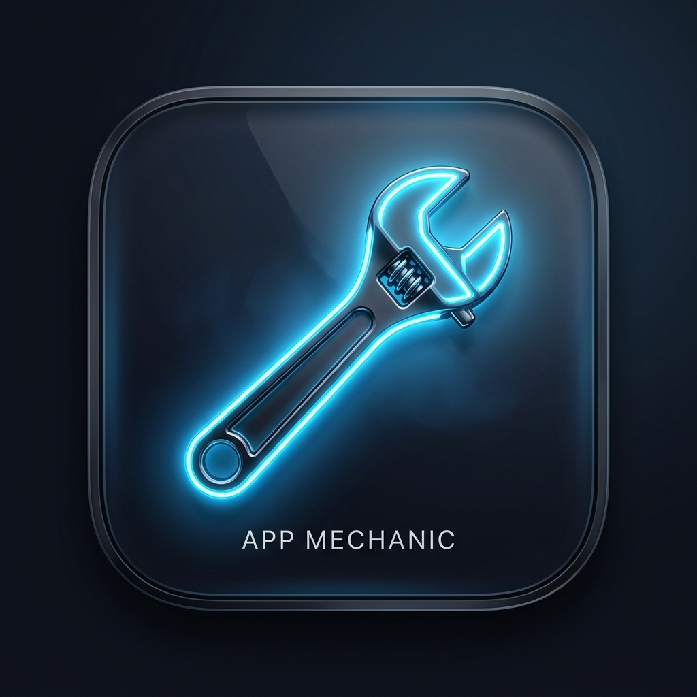

# App Mechanic (`v0.6.3`)



**App Mechanic** is a sleek, zero-dependency macOS utility written in pure Python that scans your installed `/Applications` and developer CLI toolchains against **Homebrew Casks**, **Mac App Store (`mas`)**, **Homebrew Formulae**, **NPM Global**, **Python `uv` & `pipx`**, and **25+ AI & Vibe-Coding CLI release channels**.

🌐 **Official Website & Live Interactive Simulator:** [https://appmechanic.dev](https://appmechanic.dev) (companion repo: [`liederdigital/appmechanic.dev`](https://github.com/liederdigital/appmechanic.dev))  
⚡ **Get App Mechanic Pro (\$12 once, no subscription):** [https://store.liederdigital.com/l/appmechanic](https://store.liederdigital.com/l/appmechanic)

It serves a glassmorphic dark-mode dashboard directly on `http://localhost:8000` so you can see the health of your entire Mac software stack at a glance.

---

## Features

### Free Starter Tier
- **3 Free Full macOS GUI Scans:** Scans `/Applications` against Homebrew Casks and the Mac App Store (`mas`).
- **Smart Auto-Updater Filtering:** Recognizes self-updating apps (Cursor, VS Code, Obsidian, Slack, Discord, Claude, ChatGPT, Spotify, Figma, etc.) and filters out unstable `beta`, `nightly`, and `canary` casks.
- **50-Scan Local History Log:** Tracks your overall system health percentage over time in `~/Library/Application Support/AppMechanic/history.json`.
- **macOS System Update Detection:** Inspects `com.apple.SoftwareUpdate.plist` and displays a header badge when a macOS update is waiting.

### App Mechanic Pro (`$12` One-Time License via Gumroad)
- **Unlimited System Scans** anytime.
- **🤖 25+ AI & Vibe-Coding CLI Scanner (Pro Exclusive):** Detects and checks installed versions against official release channels for:
  - **Claude Code** (`claude`), **Grok Build** (`grok`), **Meta Muse** (`muse`), **Mistral Vibe** (`vibe`), **OpenAI Codex** (`codex`), **Google Gemini CLI** (`gemini`), **Moonshot Kimi** (`kimi`), **Herdr** (`herdr`), **Hermes Agent** (`hermes`), **OpenClaw** (`openclaw`), **Sourcegraph Amp** (`amp`), **OpenCode** (`opencode`), **Alibaba Qwen Code** (`qwen`), **Cline** (`cline`), **Kilo Code** (`kilo`), **Pi Coding Agent** (`pi`), **GitHub Copilot CLI** (`copilot`), **Aider** (`aider`), **Letta** (`letta`), **OpenHands** (`openhands`), **Block Goose** (`goose`), **Mercury CLI** (`mercury`), **Basecamp CLI** (`basecamp`), and **Antigravity CLI** (`agy`).
- **🛠️ Developer Package Manager Scanner (Pro Exclusive):** Scans **Homebrew Formulae** (`brew leaves`), **NPM Global** (`npm outdated -g`), **Python `uv` tools** (`uv tool list`), and **Pipx** (`pipx list`).
- **⬆️ 1-Click Terminal CLI Upgrades & 🚀 1-Click App Launch:** Dispatches AppleScript to macOS Terminal to run the exact native upgrade command (`claude update`, `grok update`, `MUSE_SYNC_UPDATE=1 muse --version`, `codex update`, `herdr update`, `basecamp upgrade`, `brew upgrade`, `uv tool upgrade`, `npm install -g`, etc.) or opens outdated Mac App Store apps directly to their `macappstore://` page.
- **🚫 Ignore Releases & 🚩 Flag False Alarms:** Skip specific point updates (`ignored_releases.json`) or flag catalog mismatches (`false_alarms.json`) as green/healthy with a 1-click GitHub Issue / Email diagnostic reporter.

---

## Prerequisites & Dependencies
App Mechanic uses only the Python standard library (`0` third-party Python packages required). To scan standard GUI apps and Mac App Store apps accurately, install:

1. **Homebrew**: Used to check the latest versions of standard macOS apps and CLI formulae. Install from [brew.sh](https://brew.sh).
2. **`mas` (Mac App Store CLI)**: Used to check the latest versions of App Store apps. Install via Homebrew:
   ```bash
   brew install mas
   ```

---

## Installation

App Mechanic is officially code-signed with a Developer ID by **Lieder Digital, LLC** and **Notarized by Apple**.

1. Download the latest `AppMechanic-v0.6.3-Signed.zip` from the [GitHub Releases](https://github.com/liederdigital/app-mechanic/releases/latest) page (or [appmechanic.dev](https://appmechanic.dev)).
2. Double-click to extract the `.zip`.
3. Drag `App Mechanic.app` into your `/Applications` folder and double-click to launch!

---

## Architecture & Repository Layout
- **Application Repo (`liederdigital/app-mechanic`)**:
  - [`app_mechanic.py`](app_mechanic.py) — Single-file Python scanner, local HTTP server (`127.0.0.1:8000`), Gumroad `/v2/licenses/verify` client, and embedded glassmorphic web UI.
  - [`setup.py`](setup.py) & [`build.sh`](build.sh) — `py2app` bundling, Developer ID code signing, Apple `notarytool` submission, and `stapler` packaging.
  - [`docs/`](docs/) — Redirect to official website and live interactive simulator at [appmechanic.dev](https://appmechanic.dev).
  - [`CREDITS.md`](CREDITS.md) — Complete build provenance and AI/tool attribution log.
- **Website Repo ([`liederdigital/appmechanic.dev`](https://github.com/liederdigital/appmechanic.dev))**:
  - Deployed via Cloudflare Pages (`app-mechanic.pages.dev`) to **[https://appmechanic.dev](https://appmechanic.dev)**.

---

## License & Disclaimer
This software is provided under the **MIT License** by Lieder Digital, LLC.

**WARNING:** This software comes with **ABSOLUTELY NO WARRANTIES WHATSOEVER**. While it definitely won't break your computer or delete your emails and passwords, Lieder Digital, LLC is not responsible if it accidentally leaves the back door open and your dog runs away from home. Use at your own risk! See the [LICENSE](LICENSE) file for more details.

Build provenance and AI/tool attribution are documented in [CREDITS.md](CREDITS.md).
